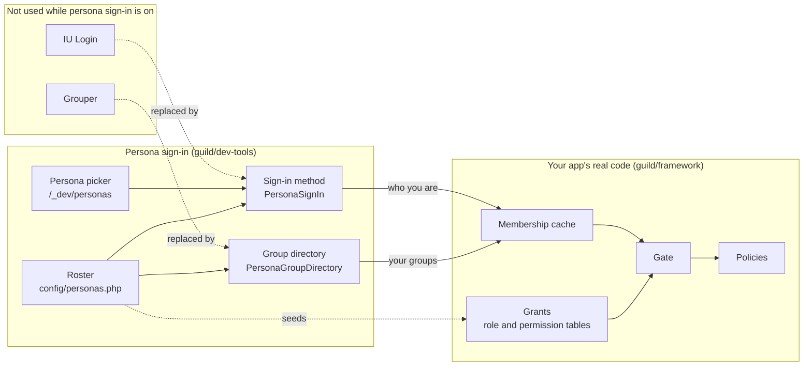

# How persona sign-in works

> For app developers who want to know what persona sign-in fakes and what stays real.

Diagram as text

While persona sign-in is on, your app doesn't use IU Login or Grouper. The sign-in method `PersonaSignIn`
replaces IU Login, and you reach it through the persona picker at `/_dev/personas`. The group directory
`PersonaGroupDirectory` replaces Grouper. Both read the roster in `config/personas.php`, and the roster
also seeds the grant tables.

Everything after that is your app's real code, from guild/framework. The sign-in method says who you are
and the group directory says which groups you're in, and both answers go to the membership cache. The Gate
reads the cache and the grant tables, which map your groups to roles and permissions, and your policies
decide. So a page that works for a persona works for a real user in the same Grouper groups, as long as
the roster names the real groups.

A Guild app gets two answers from outside services: who you are, from IU Login, and which groups you're
in, from Grouper. Persona sign-in gives both answers from your roster instead.

## Grants come from the roster

The roster's `grants:` are written into the framework's grant tables by the same models the
administration pages use. This happens when the picker opens and, in tests, on each test's first request.
With no `grants:`, nothing is written and the database isn't touched.

Rows are matched by group identifier, role name and permission value. A missing row is added and an
inactive one reactivated, but nothing is deleted or detached, and a group you renamed keeps its name. So a
grant you add at `/framework/authorization` survives. The trade-off is that removing a grant from the
roster leaves its rows in place and active until an administrator deactivates them there.

## The membership cache is real too

Because the framework's membership cache sits in front of the persona group directory, a simulated
Grouper outage behaves like a real one. Cached membership answers first, then stale membership, then the
503 page. The framework README's
[authorization setup](https://github.com/nathanskky/guild-framework/blob/main/README.md#setting-it-up)
names the settings that control this.

## How it turns on

The package is a `guild-extension`, so the framework finds it at boot with no change to
`config/app.php`; the framework README describes
[extensions](https://github.com/nathanskky/guild-framework/blob/main/README.md#extensions). While
`PERSONA_SIGN_IN_ENABLED` is off, the extension does nothing. While it's on, the app doesn't read
`config/authentication.php` or `config/grouper.php`, and the roster's System Admin group replaces the
label in `config/authorization.php`.

## Tests take the same path

The test kit loads your app from `config/app.php` for each request, as a real request would. It then
swaps in a test session, an in-memory SQLite database and a silent logger. Persona sign-in, the grants,
the Gate and your policies all run as they do in the browser.

## Related

- [Safety](safety.md) explains what keeps persona sign-in out of production.
- [Glossary](../reference/glossary.md) defines persona, roster and the other terms on this page.
- `PersonaRoster`, `PersonaGrantSeeder` and `VisitsApplication` document their details in their docblocks.
