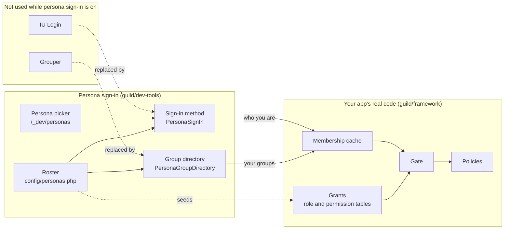

# How persona sign-in works

> For app developers who want to know what persona sign-in replaces and what it leaves unchanged.

A Guild app gets two answers from outside services: who you are, from IU Login, and which groups you're
in, from Grouper. Persona sign-in gives both answers from your roster instead.

Diagram as text

While persona sign-in is on, your app doesn't call IU Login or Grouper. The sign-in method `PersonaSignIn`
takes the place of IU Login, and you reach it through the persona picker at `/_dev/personas`. The group
directory `PersonaGroupDirectory` takes the place of Grouper. Both read the roster in `config/personas.php`.
The roster also seeds the framework's grant tables.

From that point on, your app runs its own code from guild/framework. The sign-in method reports who you are,
the group directory reports your groups, and the framework stores both in the membership cache. The Gate
reads the cache and the grant tables, which map groups to roles and permissions. When a check names a
resource, your policy for that resource must also allow it.

A page that works for a persona works for a real user in the same Grouper groups, provided the roster uses
the real group names.

## Grants

When the picker opens, dev-tools writes the roster's `grants:` into the framework's grant tables, using the
same models as the administration pages. In tests, it writes them on each test's first request. If the
roster has no `grants:`, dev-tools writes nothing and doesn't open a database connection.

Rows are matched by group identifier, role name and permission value. Seeding adds missing rows and
reactivates inactive ones. It never deletes or detaches a row, and it doesn't overwrite a group name you
changed. A grant you add at `/framework/authorization` therefore stays in place. Removing a grant from the
roster doesn't remove its rows, though: they stay active until an administrator deactivates them at
`/framework/authorization`.

## Membership cache and Grouper outages

The framework's membership cache sits in front of the persona group directory, as it does in front of
Grouper. A simulated Grouper outage therefore behaves like a real one: the app uses cached membership
first, then stale membership, and then shows the 503 page. The framework README's
[authorization setup](https://github.com/nathanskky/guild-framework/blob/main/README.md#setting-it-up)
lists the settings that control the cache.

## Enabling persona sign-in

dev-tools is a Composer package of type `guild-extension`, so the framework finds it at boot without any
change to `config/app.php`. The framework README describes
[extensions](https://github.com/nathanskky/guild-framework/blob/main/README.md#extensions). The extension
does nothing while `PERSONA_SIGN_IN_ENABLED` is off. While it's on, the app doesn't read
`config/authentication.php` or `config/grouper.php`, and the roster's System Admin group replaces the label
in `config/authorization.php`.

## Persona sign-in in tests

For each request, the test kit loads your app from `config/app.php`, the same way a real request does. It
then replaces the session, database and logger with a test session, an in-memory SQLite database and a
logger that discards its output. Persona sign-in, grant seeding, the Gate and your policies run the same
code as in the browser.

## Related

- [Safety](safety.md) explains what keeps persona sign-in out of production.
- [Glossary](../reference/glossary.md) defines persona, roster and the other terms on this page.
- `PersonaRoster`, `PersonaGrantSeeder` and `VisitsApplication` document their details in their docblocks.
