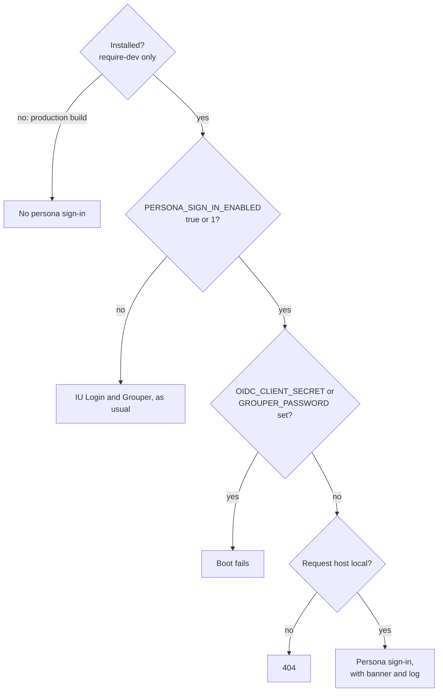

# Safety

> For app developers and reviewers checking that persona sign-in can't reach production.

Persona sign-in lets anyone become anyone, so it's built in layers. The first three layers each keep it
out of production on their own. The rest limit what it can do where it does run.

| Layer | What it does |
|---|---|
| Absent from production | Installed with `require-dev`, so a `--no-dev` build doesn't contain it. |
| Off unless chosen | Inactive unless `PERSONA_SIGN_IN_ENABLED` is `true` or `1`. |
| Refuses real credentials | Boot fails if `OIDC_CLIENT_SECRET` or `GROUPER_PASSWORD` is set while it's on. |
| Local hosts only | Sign-in and the picker answer only on `localhost`, `127.0.0.1` or `::1`; other hosts get 404 and no banner. |
| Visible | A banner on every full HTML page (one with a `<body>` tag) says who you're signed in as. |
| Session hygiene | The session ID and CSRF token are replaced on every switch and sign-out. |
| Audited | Each switch and sign-out is logged at `notice` with the persona's key, as is each outage toggle. |

The host check reads the request's `Host` header, which the client controls. So it stops accidents, not a
crafted request; keeping the package out of production builds stops those.

Refusing real credentials covers the likeliest mistake. A stack with IU Login or Grouper secrets is set up
for real users, so persona sign-in won't start beside them. A secret counts as set if it's
non-blank in either the process environment or `$_ENV`.

## Related

- [Environment reference](../reference/environment.md) lists the variables and the values each accepts.
- [How persona sign-in works](how-persona-sign-in-works.md) shows what persona sign-in replaces.
