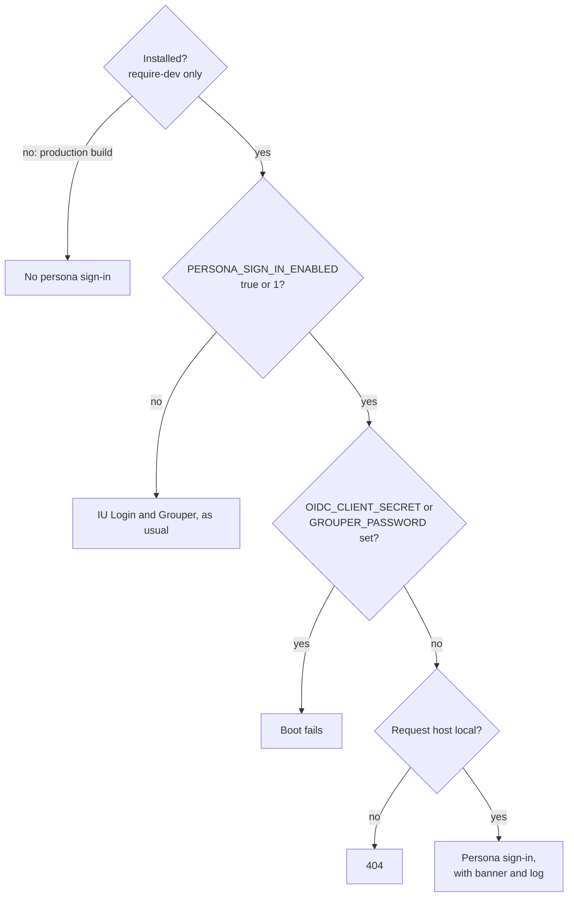

# Safety

> For app developers and reviewers checking that persona sign-in can't reach production.

Diagram as text

Persona sign-in runs only after four checks, in this order:

1. Is dev-tools installed? It's a `require-dev` package, so a production build has no persona sign-in.
2. Is `PERSONA_SIGN_IN_ENABLED` `true` or `1`? If not, the app uses IU Login and Grouper as usual.
3. Is `OIDC_CLIENT_SECRET` or `GROUPER_PASSWORD` set? If so, boot fails.
4. Is the request's host local? If not, the request gets a 404.

When all four pass, persona sign-in runs, with the banner and the log.

Persona sign-in lets anyone sign in as any persona, with that persona's groups and grants, and no
password. Several independent safeguards protect it. Each of the first three keeps persona sign-in out of
production on its own. The other four limit what persona sign-in can do where it runs.

| Safeguard | What it does |
|---|---|
| Not installed in production | Installed with `require-dev`, so a `--no-dev` build doesn't contain it. |
| Off by default | Inactive unless `PERSONA_SIGN_IN_ENABLED` is `true` or `1`. |
| Refuses real credentials | Boot fails if `OIDC_CLIENT_SECRET` or `GROUPER_PASSWORD` is set while it's on. |
| Local hosts only | Sign-in and the picker answer only on `localhost`, `127.0.0.1` or `::1`; other hosts get 404 and no banner. |
| Banner | A banner on every full HTML page (a page with a `<body>` tag) says who you're signed in as. |
| Session renewal | The session ID and CSRF token are replaced on every switch and sign-out. |
| Logging | Each switch, sign-out and outage toggle is logged at `notice` with the persona's key. |

The host check reads the request's `Host` header, which the client controls, so a crafted request can
pass it. The host check guards against mistakes. Against a crafted request, the protection is that
production builds don't contain the package.

The credentials check covers the most likely mistake: turning on the persona flag in an environment set
up for real users. Such an environment has IU Login or Grouper secrets, so persona sign-in refuses to
start there.

## Related

- [Environment variables](../reference/environment-variables.md) lists the variables and the values each accepts.
- [Boot failures](../reference/boot-failures.md) lists what each refusal to boot says.
- [How persona sign-in works](how-persona-sign-in-works.md) shows what persona sign-in replaces.
